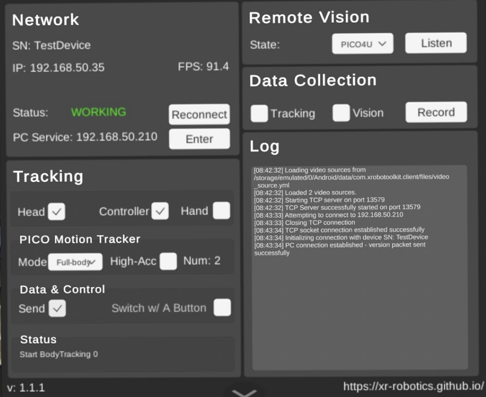
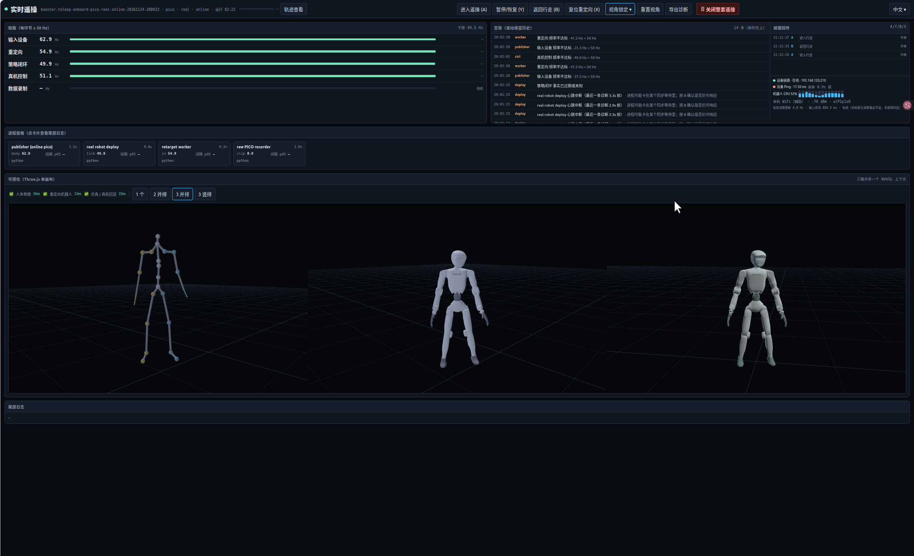

# Booster Teleoperation

English | [简体中文](README.zh-CN.md)

This repository provides whole-body teleoperation for Booster T2 in simulation and on the real robot, using either PICO or a Noitom motion-capture suit.

# Important Safety Notes
1. Before deploying on the real robot, make sure the robot is switched to **gait mode** and standing stably.
2. Ensure a good network connection. Keep the latency between the robot and the motion-capture device (PICO or motion-capture suit) below 10 ms, preferably below 5 ms. Use a wired connection when wireless interference is high.
3. Use stable releases: a system version newer than `JetPack 7.2-V1.2` and Booster firmware **newer than `1.8.4`**. The onboard installer and teleoperation launcher check the firmware automatically. Check the versions manually with:

    ```bash
    cat /opt/booster/version.txt
    cat /etc/image-version
    ```
4. For PICO calibration, wear the motion trackers on the **front of both ankles**. Keep them clear of clothing by rolling up your pant legs or smoothing out folds. Stand with your feet together and avoid bright spots that could interfere with tracking.

# T2 Policy Models

Both PICO and Noitom use **M0-1010** (`t2_gmc_rt`), with `retarget` input and
`command` as the action residual baseline. The policy adds a scaled 31-joint action residual
to the reference joint positions.

# Environment Setup
The project uses `uv` and the provided scripts for one-command installation on the
onboard computer and the host computer. Make sure you have a working network connection:
```bash
cd $PATH_TO_THIS_PROJECT
bash scripts/install_env.sh
```
Follow the installation prompts: **Host** installs the x86_64 teleoperation and
simulation environment; **Onboard** installs the AArch64 environment for the robot.
For an existing onboard installation, `bash scripts/install_env.sh --role onboard --yes --check-only`
checks the local environment and runs diagnostics without installing packages or
starting robot control.

# PICO Teleoperation

After completing the environment setup, continue with the steps below. Always finish
testing in simulation before running experiments on the real robot.

## PICO Setup
- Prepare the PICO headset, two controllers, and two motion trackers. Connect the headset and the robot to the **same Wi-Fi network**.
- [PICO software installation](docs/EN/pico-software-installation.md)
- [PICO calibration and connection](docs/EN/pico-calibration-and-connection.md)

## Connecting PICO
```bash
ssh booster@IP
```
On the onboard computer, enter the project directory:
```bash
cd ~/booster_whole_body_teleoperation
```
Run `env_set.sh` in the terminal and select **Onboard**, then **PICO**:
```bash
source scripts/env_set.sh
```
- Open the XRoboToolkit app on PICO, select **Enter**, and enter the IP address of the computer running the terminal. After connecting, enable the options shown below:



## Interactive Launcher

On the machine that will run teleoperation, open a terminal in the repository and run the launcher without arguments:

```bash
bash scripts/teleop_tmux.sh
```

Type an option number and press Enter, or press Enter alone to accept the value in brackets, such as `[1]`. The launcher skips menus that do not apply, so the `Step` numbers vary with your selections.

| Prompt | Which option to choose |
| --- | --- |
| **Deployment machine** (`choose deployment machine`) | `1` Host computer (Linux x86_64), simulation only; `2` robot's onboard computer (Linux AArch64), simulation or real robot. |
| **Input source** (`choose input source`) | `1` Noitom motion-capture suit (`Mocap`); `2` PICO. For offline replay, choose the device that made the recording, not the device currently connected. |
| **Deployment mode** (`choose deployment mode`) | `1` Simulation, to verify retargeting first; `2` Real robot, after simulation checks pass and the robot is in gait mode and standing stably. The host computer automatically uses simulation. |
| **Input timeline** (`choose input timeline`) | `1` Online, to stream live device input; `2` Offline, to replay an existing recording without connecting the motion-capture device. |
| **Trajectory recording** (`traj recording for this session`) | Shown for online PICO and online Noitom on the onboard computer. `1` Off (default); `2` On. See [Data Recording and Replay](#data-recording-and-replay) below. |
| **Hand control** | Whether to control the dexterous hands on the real robot: `1` On; `2` Off. |

- **Offline replay:** The launcher does not prompt for a path. It picks the newest compatible recording by modification time: a raw PICO `.npz` in `logs/pico_raw/` or a Noitom PN-Link `.bvh` in `logs/mocap_raw/`. If no compatible file is found, the launcher exits with an error. Use `--recording PATH` to specify a file that matches the selected source.
- **Online Noitom:** If not already configured, enter `Mocap local IP` (the address of the interface on the machine running the launcher that connects to the suit network) and `Mocap server IP` (the address configured on the suit).

## Starting Simulation
Start simulation on the onboard computer:
```bash
bash scripts/teleop_tmux.sh onboard pico sim
```
Start simulation on the host computer:
```bash
bash scripts/teleop_tmux.sh host pico sim
```
The terminal prints the dashboard URL. Check the human, retargeted robot, and
simulation views on the same page; the top-right corner switches between Chinese and
English. With `--close-ui`, the launcher keeps using the separate viewers and the
terminal/tmux path.




## Running on the Real Robot
The steps are the same as for simulation. Connect to the onboard computer over SSH and
make sure the robot is in **gait mode**:
```bash
bash scripts/teleop_tmux.sh onboard pico real
```
The views show the raw human skeleton streamed from PICO and the motion retargeted to T2.

Check that the T2 retargeting is correct, especially the arm motion, then press `A`
to start teleoperation on the real robot.

**State machine**
- The PICO buttons match the T2 remote-controller buttons.
- **A**: switch from walking gait to realtime teleoperation.
- **B**: exit teleoperation and return to walking gait.
- **Y**: pause teleoperation at the last pose during teleoperation; press again to resume.
- **X**: when using retargeting, reset it while the robot is in gait mode.
- Hold **B+X** for one second to request teleoperation shutdown; the existing robot-mode safety confirmation still applies.

# Noitom Motion Capture Teleoperation

## Suit Network Setup
- Follow the [network setup tutorial](https://support.noitom.com.cn/s/customer-manual/doc/572r57uc6ywn572u5lio6le5o6l5oyh5y2x-c9RAj5ZW4g) or [Motion capture suit network core concepts](docs/EN/mocap-network-setup.md). When done, ping the configured suit IP in the terminal to check connectivity.
- Calibrate the suit as described in [NOITOM suit calibration](docs/EN/noitom-suit-calibration.md).
```bash
source scripts/env_set.sh
```
Follow the prompts and enter the IP addresses:
- **Mocap local IP**: the **host or onboard computer IP**.
- **Mocap server IP**: the **configured suit IP**.
```bash
python scripts/calibrate.py --viser
```

## Starting Simulation
```bash
bash scripts/teleop_tmux.sh onboard mocap sim
```
The same as the PICO steps: on a host computer only change `onboard` to `host`. By
default, check every view on the dashboard page; the retargeted robot motion includes
the dexterous hands, so check them as well.

## Running on the Real Robot
```bash
bash scripts/teleop_tmux.sh onboard mocap real
```
Check that the retargeting is correct, then press `A` to start teleoperation on the real robot.

# Data Recording and Replay

## Online Recording

Enable `traj` recording in the launcher or pass `--record on`. Recording does not start automatically:

- **PICO:** On the **PICO controller**, hold both triggers and press `X` to start; hold both triggers and press `Y` to stop and save. Raw NPZ clips go to `logs/pico_raw/` by default.
- **Noitom:** On the **robot remote controller**, hold `LT` and `RT` and press `X` to start or `Y` to stop and save. Raw PN-Link BVH clips go to `logs/mocap_raw/` by default.

Use `--record-dir DIR` to change the output directory.

## Offline Replay and Diagnostics

Replay a raw PICO NPZ clip or a Noitom BVH clip in simulation without live input.
Replace the example paths with your own clips:

```bash
bash scripts/teleop_tmux.sh host pico sim --replay offline --recording /path/to/clip.npz
bash scripts/teleop_tmux.sh host mocap sim --replay offline --recording /path/to/clip.bvh
```

If `--recording` is omitted, the launcher uses the newest compatible clip under
`logs/pico_raw` (PICO) or `logs/mocap_raw` (Noitom). Use `--dry-run` to print the
commands without starting tmux or accessing hardware.

# Acknowledgments

This implementation draws on the following excellent open-source projects:

- **[GMR (General Motion Retargeting)](https://github.com/YanjieZe/GMR)** — **MIT License**.
- **[somehand](https://github.com/BotRunner64/somehand)** — **Apache 2.0 License**.
- **[XR-Robotics / XRoboToolkit](https://github.com/XR-Robotics)** — **MIT License**.
- **[pnmocap/mocapapi_python](https://github.com/pnmocap/mocapapi_python)** — **MIT License**.
- **[NVlabs/GR00T-WholeBodyControl](https://github.com/NVlabs/GR00T-WholeBodyControl)** — **Apache 2.0 License**.
