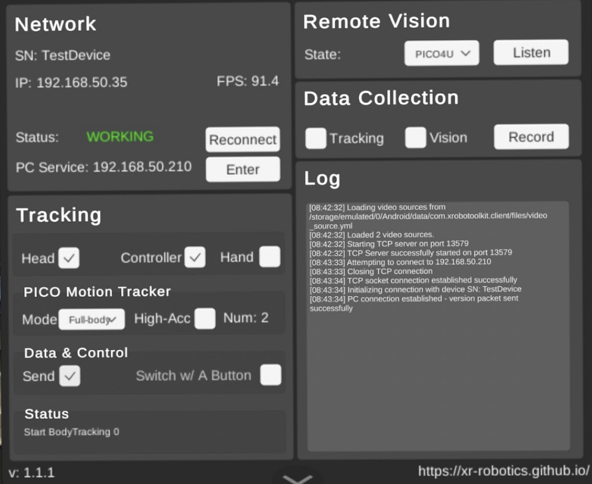
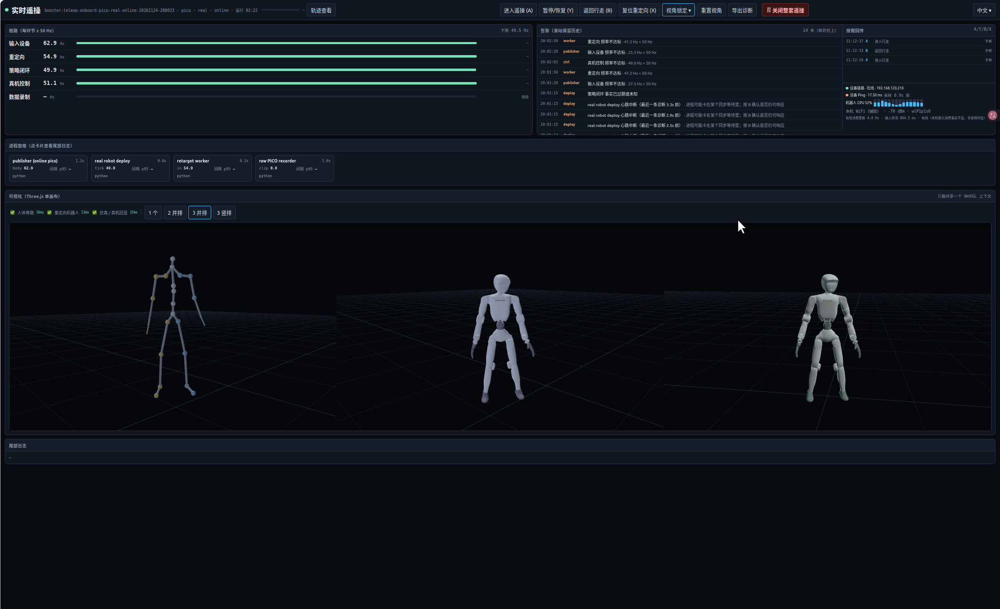

# Booster Teleoperation

[English](README.md) | 简体中文

本仓库提供Booster T2 全身遥操，支持使用 PICO 或 Noitom 动捕服进行仿真和真机遥操。

# 注意事项[重要!!!]
1. 真机部署前,机器人需要确保切换到步态模式, 保持稳定站立
2. 确保网络环境良好, 机器人与动捕设备（PICO/动捕服）设备延迟在10ms以内, 最好在5ms以内, 无线干扰大的情况下使用有线连接
3. 使用稳定 release 版本：系统版本高于`JetPack 7.2-V1.2`，Booster 固件版本 **高于 `1.8.4`**。板载安装和遥操启动时会自动校验固件。可执行以下命令手动查看：

    ```bash
    cat /opt/booster/version.txt
    cat /etc/image-version
    ```
4. PICO校准: 请确保正确将体感追踪器佩戴在**双脚脚踝前侧**，并且避免衣物遮挡追踪器, 建议全程**提起裤脚或拉平褶皱**, 双脚并拢, 确保环境中**没有光斑干扰**

# T2 模型说明

PICO 和 Noitom 均使用 **M0-1010**（`t2_gmc_rt`），输入为 `retarget`，动作残差基准为 `command`。
策略在参考关节位置上叠加经缩放的 31 关节动作残差。

# 环境配置
本项目使用uv与配套脚本执行在板载机与上位机的一键安装, 需要保证网络环境良好:
```bash
cd $PATH_TO_THIS_PROJECT
bash scripts/install_env.sh
```
按提示选择安装角色：**Host** 安装 x86_64 上位机遥操与仿真环境；**Onboard** 安装 AArch64 板载环境。
板载环境已安装时，可运行 `bash scripts/install_env.sh --role onboard --yes --check-only`，
检查本地环境并运行诊断，不安装软件包，也不启动机器人控制。

# PICO 遥操使用
在完成环境配置后，继续下面的操作, 务必先在仿真中完成测试, 再启动真机实验;

## PICO 的配置
- 准备好PICO硬件: 头显, 两个控制手柄, 两个追踪器, 并与**机器人连接至相同的WIFI**;
- [PICO 软件安装](docs/ZH/PICO软件安装.md)
- [PICO 的校准与连接](docs/ZH/PICO的校准与连接.md)

## PICO 的连接
```bash
ssh booster@IP
```
在板载机中进入项目文件夹
```bash
cd ~/booster_whole_body_teleoperation
```
在终端中运行`env_set.sh`，依次选择Onboard，再选择 PICO 
```bash
source scripts/env_set.sh
```
- 在PICO中打开XRoboToolKit应用, 点击Enter输入终端所在机器IP, 成功连接后配置勾选如下:



## 主入口选项

在**实际运行遥操的机器**上打开终端，进入仓库目录，不带参数运行：

```bash
bash scripts/teleop_tmux.sh
```

输入选项编号后按回车；直接按回车会使用方括号中的默认值，例如 `[1]`。脚本会按需跳过不适用的菜单，因此 `Step` 编号会随选择变化。

| 菜单 | 怎么选 |
| --- | --- |
| **运行位置**（`choose deployment machine`） | `1` 上位机（Linux x86_64），只运行仿真；`2` 机器人板载机（Linux AArch64），可运行仿真或真机。 |
| **输入设备**（`choose input source`） | `1` Noitom 动捕服（`Mocap`）；`2` PICO。离线时按录制来源选择，而不是按当前连接的设备选择。 |
| **运行模式**（`choose deployment mode`） | `1` 仿真（`Simulation`），先验证重定向；`2` 真机（`Real robot`），仿真验证通过、机器人进入步态模式并稳定站立后再选。上位机自动使用仿真。 |
| **输入方式**（`choose input timeline`） | `1` 在线（`Online`），读取设备实时数据；`2` 离线（`Offline`），回放已有录制，无需连接动捕设备。 |
| **轨迹录制**（`traj recording for this session`） | PICO 在线或 Noitom 板载在线时显示。`1` 关闭（默认）；`2` 开启。见下方的[数据录制与回放说明](#数据录制与回放)。 |
| **手部控制** | 是否控制真机灵巧手：`1` 开启，`2` 关闭。 |

- **离线回放**：启动时不询问文件路径。默认按修改时间选取最新的兼容录制：PICO 使用 `logs/pico_raw/` 下的原始 `.npz`，Noitom 使用 `logs/mocap_raw/` 下的 PN-Link `.bvh`。没有兼容录制时会报错；可加 `--recording PATH` 指定与所选设备匹配的文件。
- **Noitom 在线**：如果没有预先配置 IP，后续还会询问 `Mocap local IP`（当前运行机器上连接动捕服网络的网卡 IP）和 `Mocap server IP`（动捕服配置的 IP）。

## 启动仿真
在板载机中启动仿真
```bash
bash scripts/teleop_tmux.sh onboard pico sim
```
在上位机中启动仿真
```bash
bash scripts/teleop_tmux.sh host pico sim
```
终端会给出 dashboard 链接，在同页检查人体、重定向和仿真视图, 右上角可切换中英文界面。
使用 `--close-ui` 时沿用独立 viewer 和终端/tmux 路径。




## 启动真机
和仿真步骤相同, SSH连接板载机终端, 确保机器人处于**步态模式**:
```bash
bash scripts/teleop_tmux.sh onboard pico real
```
视图中包含原始PICO传输的人体骨骼, T2的重定向

先检查T2重定向是否正确, 尤其是手臂是否正确,  然后按`A`启动真机部署;

**状态机说明** 
- PICO按键与T2遥控器按键相同
- A 从行走步态进入实时遥操
- B 退出遥操进入行走步态
- Y 在遥操过程中暂停在最后的动作, 再次按则继续
- X 使用重定向时, 步态模式下可以重置重定向
- 长按 **B+X** 一秒请求关闭遥操，仍需通过现有机器人模式安全确认。

# Noitom 动捕服遥操使用

## 动捕服的网络配置
- 参考[网络配置教程](https://support.noitom.com.cn/s/customer-manual/doc/572r57uc6ywn572u5lio6le5o6l5oyh5y2x-c9RAj5ZW4g) 或 [网络配置核心概念](docs/ZH/动捕服网络配置核心.md), 完成后在终端ping动捕服IP, 检查是否连通;
- 执行动捕服校准操作, 见 [NOITOM动捕服校准](docs/ZH/NOITOM动捕服校准.md)
```bash
source scripts/env_set.sh
```
按提示进行设置填写IP
- **Mocap local IP** 为 **上位机或板载机IP**
- **Mocap server IP** 为 **配置的动捕服IP**
```bash
python scripts/calibrate.py --viser
```

## 启动仿真
```bash
bash scripts/teleop_tmux.sh onboard mocap sim
```
与 PICO 步骤相同，在上位机配置只需将 onboard 改为 host；默认在 dashboard 同页检查各视图，机器人重定向包括灵巧手，需要同步检查。

## 启动真机
```bash
bash scripts/teleop_tmux.sh onboard mocap real
```
检查重定向是否正确, 然后按`A`启动真机部署;

# 数据录制与回放

## 在线录制

在主入口开启 `traj` 录制（或传入 `--record on`）。开启后不会自动录制：

- **PICO**：用 **PICO 控制器**，同时按住左右扳机再按 `X` 开始、再按 `Y` 停止并保存。原始 NPZ 默认写入 `logs/pico_raw/`。
- **Noitom**：用**机器人遥控器**，按住 `LT` 和 `RT`，按 `X` 开始、按 `Y` 停止并保存。原始 PN-Link BVH 默认写入 `logs/mocap_raw/`。

可用 `--record-dir DIR` 修改输出目录。

## 离线回放与诊断

在仿真中可重放 PICO 原始 NPZ 片段或 Noitom BVH 片段，无需连接实时输入设备。
将下面的示例路径换成实际文件：

```bash
bash scripts/teleop_tmux.sh host pico sim --replay offline --recording /path/to/clip.npz
bash scripts/teleop_tmux.sh host mocap sim --replay offline --recording /path/to/clip.bvh
```

省略 `--recording` 时，启动器从 `logs/pico_raw`（PICO）或 `logs/mocap_raw`（Noitom）
选取最新的兼容片段。用 `--dry-run` 可仅打印命令，不启动 tmux，也不访问硬件。

# 致谢

本项目的实现参考以下优秀的开源项目:

- **[GMR (General Motion Retargeting)](https://github.com/YanjieZe/GMR)** —— 采用 **MIT License**。
- **[somehand](https://github.com/BotRunner64/somehand)** —— 采用 **Apache 2.0 License**。
- **[XR-Robotics / XRoboToolkit](https://github.com/XR-Robotics)** —— 采用 **MIT License**。
- **[pnmocap/mocapapi_python](https://github.com/pnmocap/mocapapi_python)** —— 采用 **MIT License**。
- **[NVlabs/GR00T-WholeBodyControl](https://github.com/NVlabs/GR00T-WholeBodyControl)** —— 采用 **Apache 2.0 License**。
