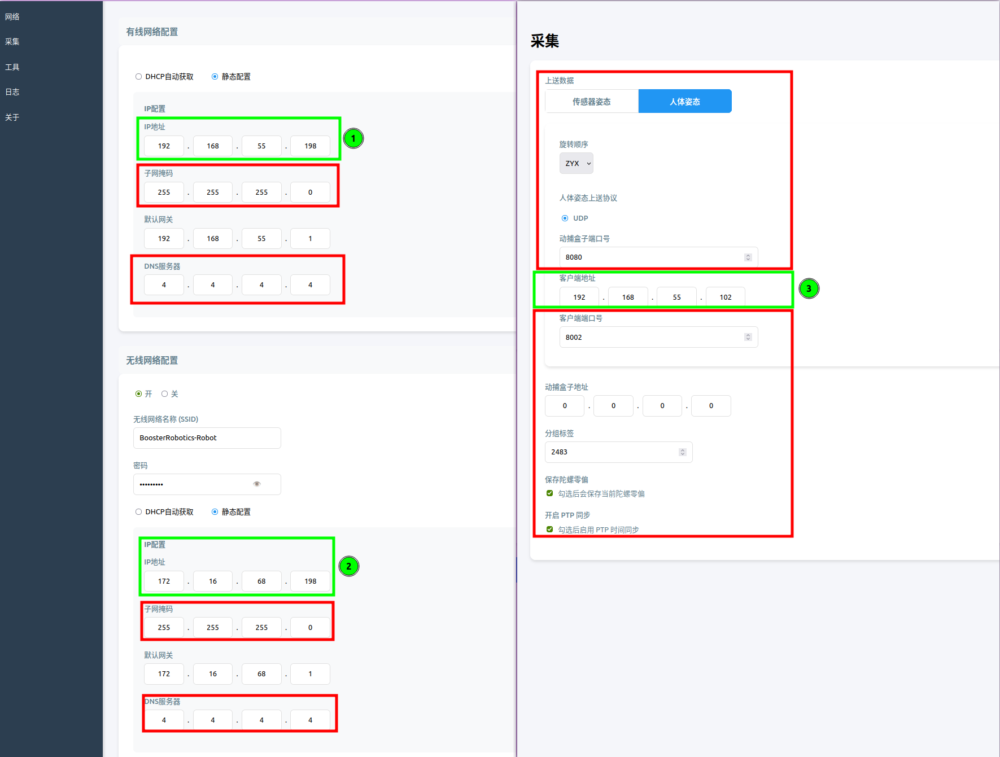
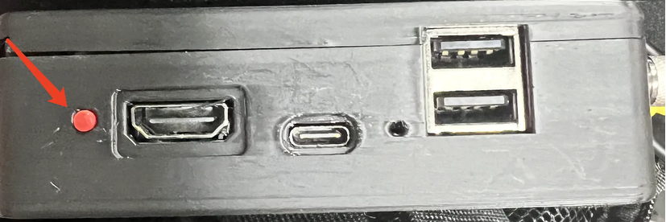

# Motion Capture Suit Network Setup

English | [简体中文](../ZH/动捕服网络配置核心.md) | [README](../../README.md)

Network setup connects the motion capture suit and the computer receiving its data on a local network. The key is to put both devices on the same subnet. Either wired or wireless connections and either static or dynamic IP assignment can be used, so the network layout is flexible.

## Configuration Interface

On first use, the suit's default IP address is `10.42.0.202`. Set your computer's wired IPv4 address to `10.42.0.X`, using an available address on the same subnet, then enter the suit's IP address in a browser to open the configuration interface. The screenshot below shows different addresses because the wired IP address has already been changed.

Leave the settings marked in red unchanged and edit only those marked in green:

- **(1)**: The suit's wired IP address, corresponding to `server ip` in this project when using a wired connection.
- **(2)**: The suit's wireless IP address, corresponding to `server ip` when using a wireless connection.
- **(3)**: The data receiver's IP address, corresponding to `local ip` in this project.

## Recovering Access When the IP Address Is Unknown

If you have forgotten the configured IP address and cannot open the suit's network configuration interface:

1. Press and hold the function button on the side of the main node until the buzzer stops.
2. Find and connect to the Wi-Fi network named `pnlinkxxxx`, using the default password `12345678`.
3. Open `http://10.42.33.1` in a browser to access the configuration interface.

