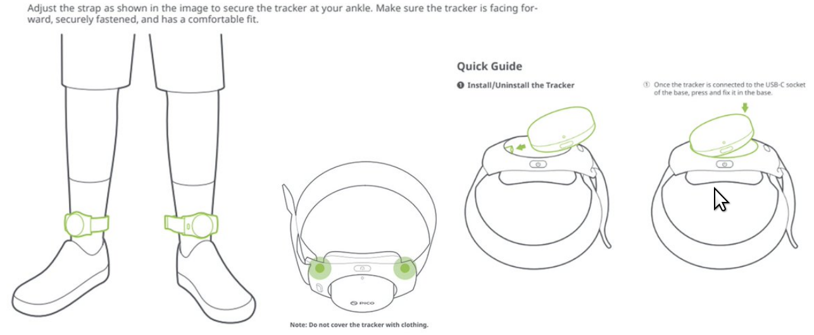

# Wearing and Calibrating PICO Trackers

English | [简体中文](../ZH/PICO的校准与连接.md) | [README](../../README.md)

PICO 4 Ultra or newer is required.

## Wearing the Trackers

- Assemble and wear the motion trackers as shown. Press and hold the button for more than 6 seconds until the indicator flashes alternately red and blue to enter pairing mode.
- Open the **Motion Tracker** app on PICO, pair the trackers, and follow the calibration instructions.
- **Keep your feet together during calibration for more stable control.**
- After calibration, wave your hands and step in place to check that tracking is correct.
