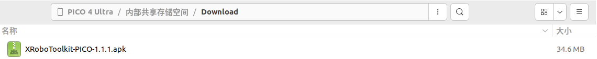

# Installing XRoboToolkit on PICO

English | [简体中文](../ZH/PICO软件安装.md) | [README](../../README.md)

The following is one convenient installation method:

1. Download the [XRoboToolkit APK](https://github.com/XR-Robotics/XRoboToolkit-Unity-Client/releases/download/v1.1.1/XRoboToolkit-PICO-1.1.1.apk).
2. Connect PICO by cable and copy the APK into its `Download` directory, as shown below:

   

3. On PICO, open the file manager, go to the installation packages, and install the APK.
