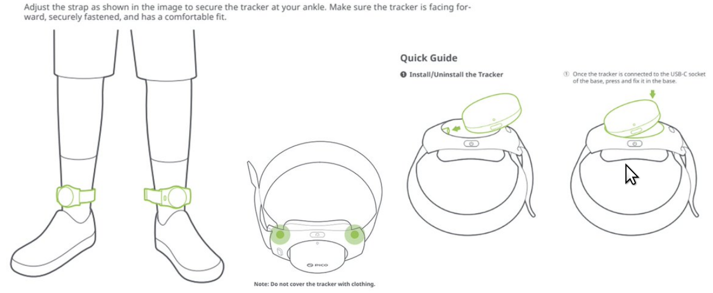

# PICO 的 佩戴与校准

简体中文 | [English](../EN/pico-calibration-and-connection.md) | [README](../../README.zh-CN.md)

PICO的使用需要PICO4 ULTRA及以上

## 佩戴

- 如图正确组装与佩戴体感追踪器, 长按6s以上, 红蓝灯交替闪烁, 进入配对模式
- 在PICO中打开[体感追踪器] APP, 先配对, 然后按照提示进行校准
- **注意**采用双脚并拢的姿势, 会获得更稳定的控制效果
- 完成后执行挥手,踏步等动作确认校准正确;
