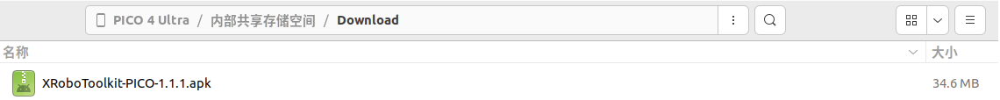

# PICO 上 XRoboToolkit 软件安装

简体中文 | [English](../EN/pico-software-installation.md) | [README](../../README.zh-CN.md)

以下仅提供一种方便可执行的方案：

- [APK 下载链接](https://github.com/XR-Robotics/XRoboToolkit-Unity-Client/releases/download/v1.1.1/XRoboToolkit-PICO-1.1.1.apk)
- 通过有线传输，将 APK 文件复制到 PICO 的 `Download` 目录下，如图所示：

  

- 进入 PICO, 文件管理, 安装包, 执行安装即可
