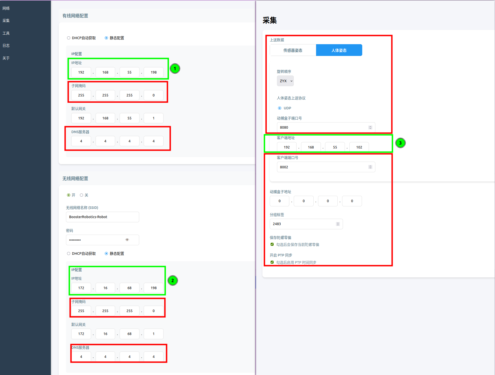
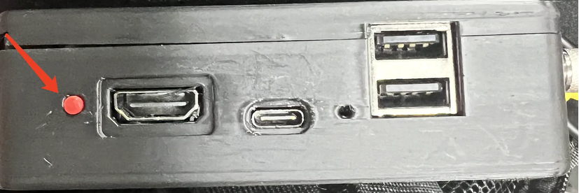

# 动捕服网络配置核心概念

简体中文 | [English](../EN/mocap-network-setup.md) | [README](../../README.zh-CN.md)

网络配置即让接收动捕服数据的设备与动捕服组成局域网连接, 关键在于配置两者到相同的网段, 与有线/无限, 静态/动态 IP分配都无关, 所以组网方式灵活.

## 配置界面
初次使用, 默认动捕服IP为10.42.0.202, 需要将本机有线IPv4设置在10.42.0.X, 然后在浏览器输入动捕服IP即可进入配置界面(本教程截图不一致, 在于已经修改了有线IP):  
其中, 红色无需改动, 只需改动绿色部分, **(1)** **(2)** 分别为有线和无线配置的动捕服IP, 对应本项目代码中的`server ip`, **(3)** 为数据接收方的IP, 对应本项目的`local ip`   
  

## 特殊故障
当配置IP忘记, 无法进入动捕服网络配置界面时, 可长按主节点侧面功能按钮，直到蜂鸣器停止, 搜索 Wi-Fi pnlinkxxxx ，密码：12345678, 浏览器输入 `浏览器输入 http://10.42.33.1` 即可进入配置界面  

